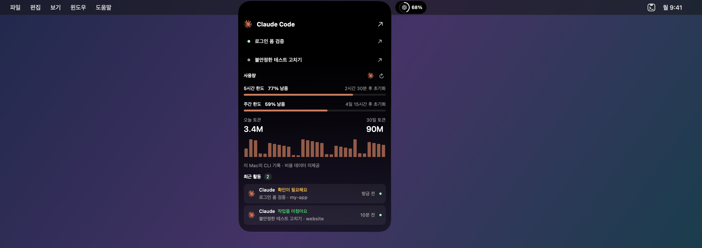
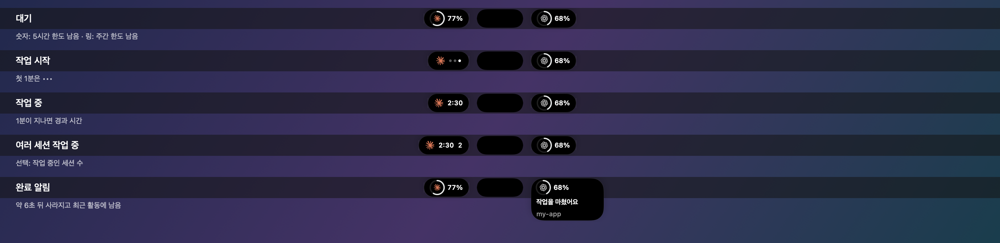
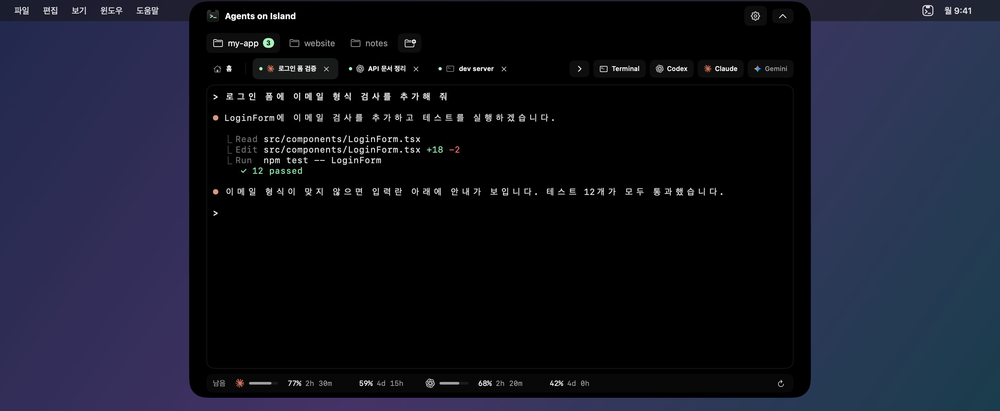
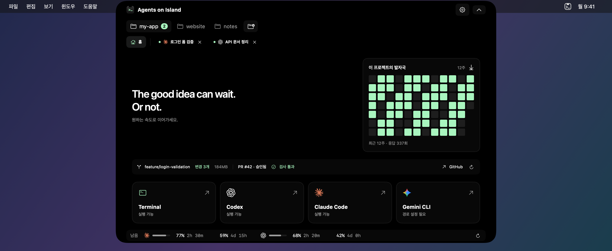

# Agents on Island

[English](README.md) · **한국어**

메뉴바에 떠 있는 AI 코딩 에이전트들의 작은 섬. Codex·Claude Code·Gemini CLI를 돌려 두고 다른 일을 하면서, 누가 일하는 중인지, 누가 끝났는지, 한도가 얼마나 남았는지 한눈에 확인하세요.

Agents on Island(AoI)는 **NotchAgent**의 새 이름입니다. 설정·프로젝트·세션은 그대로 이어집니다. 이미 설치하고 로그인한 CLI를 그대로 사용합니다.



*샘플 데이터를 사용한 앱 화면입니다.*

## 처음 시작하기

**Apple Silicon Mac, macOS 14 이상**이 필요합니다. 사용할 CLI를 설치하고 로그인해 두세요: Codex(`codex`), Claude Code(`claude`), Gemini CLI(`gemini`). 터미널만 따로 써도 됩니다.

1. [Releases](https://github.com/2betforyou/NotchAgent/releases)에서 최신 ZIP을 받습니다.
2. **Agents on Island.app**을 **응용 프로그램** 폴더로 옮기고 실행합니다.
3. **Control + Option + Space**(`⌃⌥Space`)로 작업 화면을 엽니다.
4. 폴더 추가 버튼으로 프로젝트 폴더를 추가하고 **Terminal**, **Codex**, **Claude**, **Gemini** 중 하나를 고릅니다.

Dock 아이콘은 없습니다. 섬, 단축키, 메뉴바 아이콘으로 다시 열 수 있습니다.

배포 빌드는 아직 Apple 공증을 받지 않아 처음 실행할 때 macOS가 막습니다. 앱을 한 번 연 뒤 **시스템 설정 → 개인정보 보호 및 보안**에서 **그래도 열기**를 누르세요. 버전마다 한 번만 하면 됩니다.

에이전트를 사용할 수 없다면 **설정 → 에이전트**에서 실행 파일 경로를 확인하세요. CLI 설치와 로그인은 각 CLI에서 진행합니다.

### NotchAgent에서 업데이트하기

1. 메뉴바 아이콘 → **NotchAgent 종료**로 앱을 끕니다. 종료하면 열려 있는 터미널과 에이전트 세션도 끝나니, 작업을 마치거나 멈춘 뒤 진행하세요.
2. 응용 프로그램 폴더의 **NotchAgent.app**을 지우고 **Agents on Island.app**을 옮겨 넣습니다.
3. 실행하면 프로젝트·설정·복원 가능한 세션이 그대로 돌아옵니다.
4. **로그인 시 실행**을 쓰고 있었다면 **설정 → 일반**에서 켜져 있는지 확인하세요.

자동 업데이트는 아직 없습니다. 새 버전 소식은 저장소의 릴리스를 확인하세요.

## 섬

에이전트마다 메뉴바에 작은 섬이 하나씩 생깁니다. **왼쪽은 Claude·Gemini, 오른쪽은 Codex·Terminal**입니다. 가운데는 가운데 섬입니다. 카메라 노치가 있는 맥북에서는 **노치 자체**가 그 역할을 하고(따로 그리지 않습니다), 그 밖의 화면에서는 작은 검은 캡슐이 나타납니다.

| 동작 | 결과 |
|---|---|
| 보기만 하기 | 각 섬이 에이전트 상태를 보여 줍니다: 작업 중, 알림, 남은 한도 |
| 에이전트 섬에 마우스 올리기 | 그 자리에서 해당 에이전트의 세션·한도·토큰 기록·최근 활동으로 펼쳐집니다. 옆 섬들은 펼쳐진 창에 밀려 옆으로 비켜납니다 |
| 에이전트 섬 클릭 | 그 에이전트의 세션으로 작업 화면을 엽니다. 확인이 필요한 세션 → 작업 중인 세션 → 최근 세션 순입니다 |
| 노치(또는 가운데 캡슐)나 Terminal 섬에 마우스 올리기 | 전체 미리보기를 엽니다: 프로젝트, 바로 요청, 사용량, 최근 활동 |
| 노치(또는 가운데 캡슐) 클릭 또는 `⌃⌥Space` | 작업 화면을 엽니다 |
| **Option(⌥)** 누르고 있기 | 섬들이 가운데로 모여 사라져, 아래에 가려진 메뉴바 항목을 누를 수 있습니다. 키를 놓으면 돌아옵니다 |

섬은 보여 줄 내용이 있을 때만 나타납니다. 실행 중인 세션이 없고 사용량 표시도 꺼져 있으면 Terminal 섬 하나만 남습니다.

### 섬에 보이는 것



- **작업 중**: 에이전트 아이콘과 `•••`, 1분이 지나면 경과 시간. 작업 중인 세션 수도 선택해서 표시할 수 있습니다.
- **알림**: 세션이 끝나거나 확인을 요청하면 해당 섬이 잠깐 커지며 이벤트와 프로젝트를 보여 줍니다. 약 6초 뒤 사라지고, **최근 활동**에서 다시 볼 수 있습니다.
- **대기**: 남은 한도. **숫자는 5시간 한도**, **링은 주간 한도**의 남은 비율이며 각각 20% 이하가 되면 빨갛게 바뀝니다.

**설정 → 노치 → 최소화 화면**에서 고를 수 있습니다: 쉬는 동안 사용량 표시(켬), 작업 중 표시(켬), 작업 중인 개수 표시(끔). **설정 → 알림 → 이벤트별 알림**에서 이벤트마다 **노치·알림 센터·소리**를 따로 고를 수 있습니다. 표시를 꺼도 세션은 계속 실행됩니다.

### 에이전트 미리보기

에이전트 섬에 마우스를 올리면 그 에이전트에 대해서만 다음을 보여 줍니다.

- 열려 있는 세션 최대 3개. 누르면 바로 열립니다.
- 5시간·주간 남은 한도와 재설정까지 남은 시간
- **오늘 토큰**, **30일 토큰**, 일별 그래프. 이 Mac에 남은 CLI 기록에서 계산합니다([사용량과 토큰](#사용량과-토큰) 참고).
- 해당 에이전트의 최근 활동

macOS 26 이상에서는 위쪽이 검정이고 아래로 갈수록 Liquid Glass로 바뀌는 배경을 씁니다. **투명도 줄이기**를 켜면 검정 배경을 씁니다. 터미널은 항상 검정입니다.

섬은 이 앱이 메뉴바 위에 직접 그리는 것으로, Apple의 Dynamic Island 기능이 아닙니다. 다른 메뉴바 항목을 가릴 수 있으니 그럴 때는 Option 키를 누르세요.

## 작업 화면



*샘플 데이터를 사용한 앱 화면입니다.*

### 프로젝트와 세션

작업 화면에는 프로젝트가 항상 보입니다. 폴더를 추가하고, 프로젝트를 전환하고, 폴더 칩을 끌어 순서를 바꿀 수 있습니다. 프로젝트를 우클릭하면 세션 시작, Finder에서 보기, 관리 메뉴가 나옵니다.

- 모든 프로젝트를 합쳐 **세션 탭을 최대 8개**까지 열 수 있습니다.
- 탭 이름은 CLI가 알려 주는 작업 제목입니다. 더블클릭해 이름을 바꿀 수 있습니다.
- 탭을 끌어 순서를 바꿀 수 있습니다. **홈** 탭은 각 프로젝트의 맨 왼쪽에 고정됩니다.
- 저장소 우클릭 메뉴에서 **git worktree**를 만들어 다른 브랜치에서 따로 작업할 수 있습니다. 커밋하지 않은 변경이 사라지는 제거는 막습니다.
- 전체 미리보기에서 에이전트를 고르고 **바로 요청**을 보내면, 선택한 프로젝트에서 세션이 시작됩니다. 시작하지 못하면 입력한 내용이 그대로 남습니다.

### 프로젝트 홈



*샘플 데이터를 사용한 앱 화면입니다.*

홈에는 **이 프로젝트에서 에이전트 응답이 끝난 횟수를 12주 잔디**로 보여 줍니다. 열린 세션 수나 토큰이 아니라 응답 횟수입니다. 홈의 **과거 대화 가져오기** 또는 **설정 → 에이전트**에서 로컬 Codex·Claude 기록으로 추정치를 채울 수 있고, 다시 가져와도 중복으로 더하지 않습니다. 프로젝트 경로와 날짜별 횟수만 최대 1년 보관합니다.

Git 프로젝트는 현재 브랜치, 변경 파일(누르면 목록), `.git`·의존성·빌드 결과를 포함한 디스크 사용량도 보여 줍니다. GitHub 프로젝트는 저장소 링크와 선택 기능인 **PR·검사 상태**를 추가로 보여 주며, 설치된 GitHub CLI(`gh`)의 기존 로그인으로 읽기만 합니다. push·PR 작성·병합·로그인은 하지 않습니다. **설정 → 에이전트**에서 끌 수 있습니다.

### 임시 채팅

미리보기의 **Start here** 입력창에서 **Temp**를 켜고 보내면, 프로젝트 밖의 임시 폴더(macOS 임시 폴더의 `NotchAgent-Chats`)에서 에이전트가 시작됩니다. 이 세션은 세션 복원·최근 활동 보관·프로젝트 활동에서 빠집니다.

**시크릿 모드나 샌드박스가 아닙니다.** CLI 자체 대화 기록과 파일 권한은 그대로이며, 만들어진 파일은 직접 지우거나 macOS가 정리할 때까지 남습니다.

### 파일, 터미널, 키보드

파일이나 이미지를 **터미널 안에** 놓으면 경로가 입력됩니다. 확인한 뒤 직접 Return을 누르세요. 폴더를 **섬이나 프로젝트 영역에** 놓으면 프로젝트로 추가됩니다.

터미널은 컬러 출력, 한글 입력 조합, 5,000줄 스크롤, 검색, 링크 클릭을 지원합니다. Codex는 인라인 모드(`--no-alt-screen`)로 실행해 이전 출력도 스크롤로 볼 수 있습니다.

| 동작 | 단축키·방법 |
|---|---|
| 열기 / 접기 | `⌃⌥Space`, 섬, 메뉴바 아이콘 |
| 프로젝트 홈 | `⌘1` |
| 세션 탭 | `⌘2`–`⌘9` |
| 다음 / 이전 탭 | `⇧⌘]` / `⇧⌘[` |
| 같은 종류의 새 세션 | `⌘T` |
| 확인이 필요한 세션 | `⇧⌘A` |
| 터미널 검색 | `⌘F`, 다음 `⌘G`, 이전 `⇧⌘G` |
| 링크 열기 | `⌘`+클릭 |
| 탭 이름 바꾸기 | 더블클릭 또는 우클릭 → 이름 변경 |
| 세션 끝내기 | 탭의 `×` 또는 셸에서 `exit` |

`Esc`, `⌃C`, `⌘W`는 CLI로 전달됩니다. 접을 때는 전역 단축키를 쓰세요.

### 지켜보지 않아도 따라잡기

**최근 활동**에 작업 완료, 확인 요청, 세션 종료가 모입니다. 누르면 해당 세션으로 돌아갑니다. 닫힌 Codex·Claude 세션은 **이어 열기**로 원래 프로젝트에서 저장된 대화를 다시 엽니다. 앱을 다시 실행한 뒤에도 됩니다.

최대 50개를 기기에 24시간 보관합니다. 알림 센터와 소리는 기본 꺼짐이며 **설정 → 알림**에서 이벤트별로 켤 수 있습니다. 작업 제목과 폴더는 직접 켜지 않으면 macOS 알림에 표시하지 않습니다.

Claude 훅과 Codex 완료 알림으로 정확한 이벤트를 받습니다. 그 밖의 활동은 터미널 출력으로 추정하므로 정확하지 않을 수 있습니다.

## 사용량과 토큰

**설정 → 에이전트**에서 사용할 에이전트의 사용량을 켜세요. 앱 어디서나 한도는 **남은 비율**로, 100%에서 0%로 줄어듭니다. **계정 전체의 한도**이며 현재 프로젝트만의 값이 아닙니다.

| 에이전트 | 한도 갱신 방식 |
|---|---|
| Codex | 5분마다 로컬 CLI에서 읽습니다. 직접 새로고침할 수도 있습니다 |
| Claude Code | Agents on Island에서 연 세션이 응답할 때 Claude Code가 알려 주는 값으로 갱신합니다. 새로고침은 마지막 값을 다시 읽습니다 |
| Gemini CLI | 세션 실행은 지원하지만 한도 표시는 지원하지 않습니다 |

값이 없다고 한도가 0인 것은 아닙니다. 주황 점은 값이 오래됐거나 조회에 실패했다는 뜻이며, 에이전트 아이콘을 누르면 자세한 내용과 다시 시도 버튼이 나옵니다.

에이전트 미리보기의 **토큰 수**는 이 Mac에 남은 CLI 기록(Claude는 `~/.claude/projects`, Codex는 `~/.codex/sessions`)에서 계산합니다. 다른 기기의 사용량은 포함하지 않고, 기록이 없거나 읽지 못하면 일부만 집계될 수 있습니다. Claude의 캐시 입력을 포함하고, Codex의 누적 카운터는 일별 증가분으로 더합니다. 대화 내용은 저장하거나 전송하지 않습니다. 청구 금액, 비용 추정, 크레딧은 보여 주지 않습니다.

## 접기, 종료, 다시 이어가기

**접어도 작업은 계속됩니다. 종료하면 열린 터미널과 에이전트 프로세스가 끝납니다.**

**설정 → 정보 → 앱 종료** 또는 메뉴바 아이콘으로 종료하세요. 실행 중인 에이전트나 명령을 수행 중인 셸이 있으면 먼저 확인합니다. **설정 → 에이전트 → 다시 열 때 세션 복원**을 켜 두면 다시 열었을 때 탭이 돌아오고, Codex·Claude는 저장된 대화를 이어 엽니다. 제출하지 않은 입력, 스크롤 기록, 실행 중이던 프로세스는 복원되지 않습니다.

## 설정 한눈에 보기

설정은 작업 화면 안에서 열립니다. 설정을 바꾸는 동안에도 세션은 계속 실행됩니다.

| 페이지 | 항목 |
|---|---|
| 일반 | 언어, 전역 단축키, 로그인 시 실행 |
| 노치 | 표시 화면, 호버, 자동 접기, 작업 화면 크기, 섬에 보일 내용 |
| 알림 | 이벤트별 노치·알림 센터·소리, 알림 개인정보, 최근 활동 보관 |
| 모양 | 강조색, 터미널 테마, 글꼴, 글자 크기 |
| 에이전트 | CLI 경로, 세션 복원, 사용량, 프로젝트 활동, GitHub 상태, 과거 기록 가져오기 |
| 정보 | 버전, 앱 종료 |

## 개인정보

분석 서비스나 텔레메트리가 없고, 터미널 내용을 저장하지 않습니다. 설정, 프로젝트 경로, 세션 복원 정보, 선택한 최근 활동, 프로젝트별 응답 횟수는 이 Mac에만 저장됩니다. 토큰 수와 과거 기록 가져오기를 위한 CLI 기록 읽기도 이 Mac 안에서만 이뤄지며 대화 내용은 남기지 않습니다.

실행한 CLI는 사용자 권한과 각 CLI 설정에 따라 파일을 읽고 네트워크를 사용할 수 있습니다. 손쉬운 사용·화면 기록 권한은 요청하지 않으며, 알림 권한은 알림 센터를 켤 때만 요청합니다. 자세한 내용은 [개인정보 처리방침](PRIVACY.md)과 [제3자 고지](THIRD-PARTY-NOTICES.md)를 확인하세요.

## 도움이 필요할 때

| 문제 | 확인할 것 |
|---|---|
| Dock 아이콘이 없어요 | 정상입니다. 섬, `⌃⌥Space`, 메뉴바 아이콘을 쓰세요 |
| 섬이 메뉴바 항목을 가려요 | Option(⌥)을 누르고 있으면 숨겨집니다 |
| 에이전트를 실행할 수 없어요 | CLI 설치·로그인 후 설정 → 에이전트에서 경로 확인 |
| 사용량이 안 보여요 | 설정 → 에이전트에서 켜기. Claude는 이 앱에서 연 세션의 응답이 필요합니다 |
| 알림이 안 보여요 | 설정 → 알림 → 이벤트별 알림에서 해당 이벤트의 노치 표시 확인 |
| 다른 노치·메뉴바 앱과 겹쳐요 | 다른 앱을 잠시 종료하세요 |
| 단축키가 겹쳐요 | 섬이나 메뉴바에서 연 뒤 설정에서 단축키를 바꾸세요 |

버그는 macOS·앱·CLI 버전과 재현 순서를 적어 [GitHub Issues](https://github.com/2betforyou/NotchAgent/issues)에 남겨 주세요. 그 밖의 문의: june295921@gmail.com

<details>
<summary>소스에서 빌드·테스트·패키징</summary>

전체 Xcode가 필요합니다. 의존성은 저장소에 포함되어 있습니다.

```sh
git clone https://github.com/2betforyou/NotchAgent.git
cd NotchAgent
bash Scripts/build.sh
bash Scripts/test.sh
bash Scripts/package.sh
```

`NotchAgent.xcodeproj`를 열고 **NotchAgent → My Mac**으로 실행해도 됩니다. 기존 설정이 이어지도록 Xcode 타깃과 번들 ID는 예전 이름을 유지하며, 패키징하면 앱 이름은 **Agents on Island.app**, 압축 파일은 `Agents_on_Island-<버전>-macOS.zip`이 됩니다.

빌드 결과는 기본으로 `/private/tmp/NotchAgent-build-<uid>`에 저장되며 `NOTCHAGENT_BUILD_DIR`로 바꿀 수 있습니다. 배포 준비와 서명·공증은 [docs/releases](docs/releases)를 참고하세요.

```text
Sources/    앱과 터미널 연동
Tests/      단위·PTY 통합·UI 렌더링 테스트
Scripts/    빌드·테스트·이미지·패키징·배포
Resources/  앱 정보, 아이콘, 라이선스
Vendor/     내장 SwiftTerm
```

터미널은 [SwiftTerm](https://github.com/migueldeicaza/SwiftTerm)을 사용합니다. 오류 로그 수집:

```sh
log show --last 1h --info --predicate 'subsystem == "app.notchagent.desktop"'
```

공유하기 전에 로그 내용을 확인하세요.

</details>

## 라이선스

라이선스는 아직 정하지 않았습니다. 포함된 의존성의 라이선스는 [THIRD-PARTY-NOTICES.md](THIRD-PARTY-NOTICES.md)를 확인하세요. 에이전트 이름과 로고는 외부 프로그램을 식별하기 위한 것이며 제휴나 보증을 뜻하지 않습니다.
