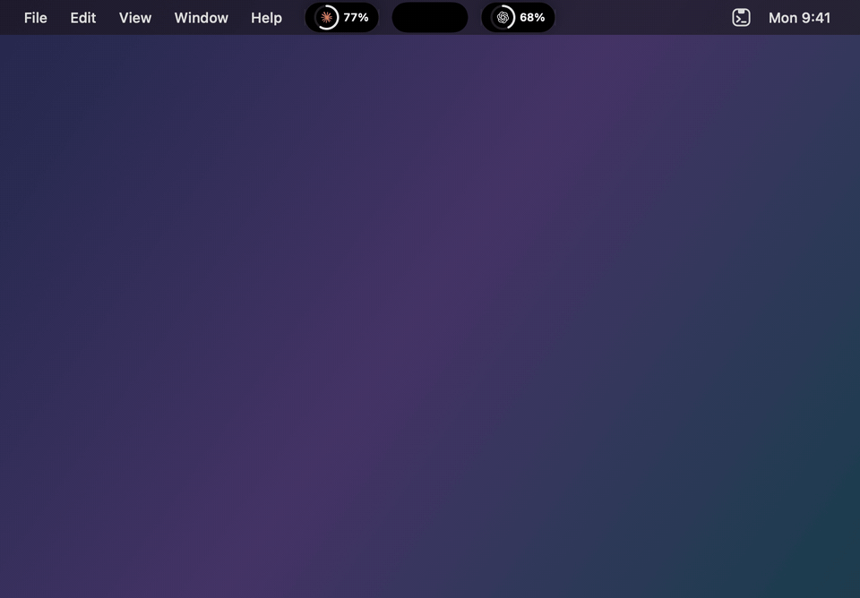
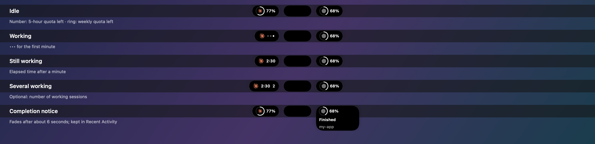
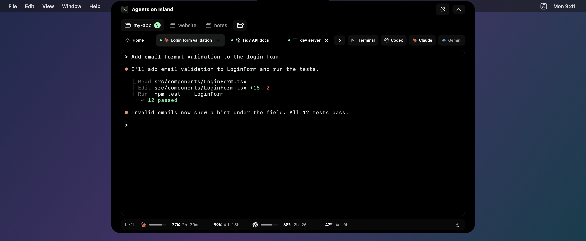
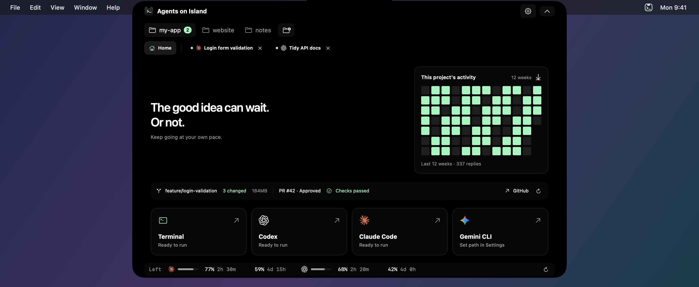

# Agents on Island

**English** · [한국어](README.ko.md)

Small islands for your AI coding agents, right in the menu bar. Keep Codex, Claude Code, and Gemini CLI running while you work, and see at a glance which one is busy, which one finished, and how much quota is left.

Agents on Island (AoI) was previously called **NotchAgent**. Your settings, projects, and sessions carry over. It uses the CLIs you already have installed and signed in.



*Hover over Claude to see its sessions and quota. The center stays in place while Codex slides aside. Demo rendered with sample data.*

### Watch the demos at 120 fps

The MP4s capture intermediate frames of the app's actual animations. The looping preview above is a 50 fps GIF.

| Demo | What it shows |
| --- | --- |
| [Agent hover](docs/images/demos/agent-hover.mp4) | Open a Claude preview, move the neighboring island aside, then collapse it |
| [Dashboard](docs/images/demos/dashboard.mp4) | Open the center preview for projects, quick prompts, and recent activity |
| [Workspace](docs/images/demos/workspace.mp4) | Open a Claude Code tab, type a sample prompt, and read the reply in the embedded terminal |
| [Completion](docs/images/demos/completion.mp4) | Move from a working indicator to a completion notice |
| [Option hide](docs/images/demos/option-hide.mp4) | Merge the side islands, hide the center, and restore the menu bar islands |
| [Settings](docs/images/demos/settings.mp4) | Open settings inside the expanded workspace |

## Get started

You need an **Apple silicon Mac with macOS 14 or later**. Install and sign in to whichever CLI you want to use: Codex (`codex`), Claude Code (`claude`), or Gemini CLI (`gemini`). You can also use the terminal on its own.

1. Download the latest ZIP from [Releases](https://github.com/2betforyou/NotchAgent/releases).
2. Move **Agents on Island.app** into **Applications** and open it.
3. Press **Control + Option + Space** (`⌃⌥Space`) to open the workspace.
4. Add a project folder with the folder-plus button, then choose **Terminal**, **Codex**, **Claude**, or **Gemini**.

There is no Dock icon. Use the islands, the shortcut, or the menu bar icon to open the app again.

Release builds aren't notarized by Apple yet, so macOS blocks the first launch. Open the app once, then go to **System Settings → Privacy & Security** and click **Open Anyway**. You only need to do this once per version.

If an agent is unavailable, open **Settings → Agents** and check its executable path. Agents on Island doesn't install CLIs or sign you in.

### Updating from NotchAgent

1. Quit NotchAgent from the menu bar icon → **Quit NotchAgent**. Quitting ends open terminal and agent sessions, so finish or pause your work first.
2. Delete **NotchAgent.app** from Applications and move in **Agents on Island.app**.
3. Open it. Projects, settings, and restorable sessions come back as before.
4. If you used **Launch at login**, check that it's still on in **Settings → General**.

There's no automatic updater yet. Watch the repository's releases to hear about new versions.

## The islands

Each agent gets its own small island in the menu bar: **Claude and Gemini on the left, Codex and Terminal on the right**. In the middle is the center island: on a MacBook with a camera notch, **the notch itself** (nothing extra is drawn); on other displays, a small black capsule.

| What you do | What happens |
|---|---|
| Glance | Each island shows its agent's state: working, a notice, or remaining quota |
| Hover over an agent's island | It expands in place into that agent's sessions, quota, token history, and recent activity. Neighboring islands slide aside to make room |
| Click an agent's island | Opens the workspace on that agent's session: one that needs you first, then one that's working, then the latest |
| Hover over the notch (or the center capsule), or the Terminal island | Opens the full preview: projects, quick request, usage, and recent activity |
| Click the notch (or the center capsule), or press `⌃⌥Space` | Opens the workspace |
| Hold **Option (⌥)** | Islands gather into the center and hide, so you can reach menu bar items underneath. Release to bring them back |

Islands appear only when they have something to show. With nothing running and usage display off, a single Terminal island remains.

### What an island shows



- **Working**: the agent's icon and `•••`, then elapsed time after a minute. Optionally, the number of sessions working.
- **Notice**: when a session finishes or needs input, its island grows briefly to show the event and project. It disappears after about six seconds; find it again in **Recent Activity**.
- **Idle**: remaining quota. The **number is the 5-hour limit left** and the **ring is the weekly limit left**; each turns red at 20% or less.

Choose these in **Settings → Notch → Collapsed notch**: show usage while idle (on), show ongoing work (on), show working session count (off). Choose **Notch**, **Notification Center**, and **Sound** separately for each event in **Settings → Alerts → Event delivery**. Turning displays off doesn't stop your sessions.

### Agent previews

Hovering an agent's island shows, for that agent only:

- Up to three open sessions. Click one to open it.
- Remaining 5-hour and weekly quota with reset times.
- **Tokens today**, **tokens over 30 days**, and a daily chart, read from the CLI's local logs on this Mac (see [Usage and tokens](#usage-and-tokens)).
- Its recent activity.

On macOS 26 and later, previews use Liquid Glass that fades from solid black at the top. With **Reduce Transparency** on, they stay solid black. The terminal is always black.

The islands are drawn by this app over the menu bar. They aren't Apple's Dynamic Island, and they can cover other menu bar items; hold Option to reach them.

## Workspace



*Illustrative app UI with sample data.*

### Projects and sessions

Projects are always visible in the workspace. Add a folder, switch projects, or drag the folder chips to reorder them. Right-click a project to start a session, reveal it in Finder, or manage it.

- Keep up to **8 session tabs across all projects**.
- Tabs use the task title reported by the CLI. Double-click a tab to rename it.
- Drag tabs to reorder them. The **Home** tab stays at the far left of each project.
- Create a **git worktree** from a repository's context menu to work on a separate branch and checkout. Removal is blocked when it would discard uncommitted changes.
- In the full preview, select an agent and send a **quick request**. It opens a session in the selected project. If launch fails, your draft stays in the input.

### Project Home



*Illustrative app UI with sample data.*

Home shows a **12-week heatmap of completed agent replies in that project**. It counts replies, not open sessions or tokens. Use **Import past conversations** on Home or in **Settings → Agents** to add estimates from local Codex and Claude history. Importing again doesn't add the same history twice. Only daily counts and project paths are saved, for up to a year.

Git projects also show the current branch, changed files (click to see names), and local disk usage including `.git`, dependencies, and build output. GitHub projects add a repository link and optional **PR & checks**, read with the installed GitHub CLI (`gh`) and its existing sign-in. It only reads: no pushes, PRs, merges, or sign-in. Turn it off in **Settings → Agents**.

### Temporary chats

In the preview's **Start here** input, turn on **Temp** before submitting. The agent starts in its own temporary folder (`NotchAgent-Chats` in the macOS temporary directory), outside your projects. These sessions are left out of session restoration, saved recent activity, and project activity.

This is **not incognito mode or a sandbox**: the CLI keeps its own history and normal file permissions, and generated files stay until you or macOS remove them.

### Files, terminal, and keyboard

Drop a file or image **inside the terminal** to insert its path; review it and press Return yourself. Drop a folder **on an island or the project area** to add it as a project.

The terminal supports color output, Korean input composition, 5,000 lines of scrollback, search, and clickable links. Codex runs in inline mode (`--no-alt-screen`) so earlier output stays scrollable.

| Action | Shortcut or control |
|---|---|
| Open / collapse | `⌃⌥Space`, an island, or the menu bar icon |
| Project Home | `⌘1` |
| Session tabs | `⌘2`–`⌘9` |
| Next / previous tab | `⇧⌘]` / `⇧⌘[` |
| New session of the current kind | `⌘T` |
| Session needing attention | `⇧⌘A` |
| Find in terminal | `⌘F`; next `⌘G`, previous `⇧⌘G` |
| Open a URL | `⌘`-click |
| Rename a tab | Double-click, or right-click → Rename |
| End a session | Tab's `×`, or `exit` in the shell |

`Esc`, `⌃C`, and `⌘W` go to the CLI. Use the global shortcut to collapse.

### Catch up without watching

**Recent Activity** collects completions, requests for input, and session endings. Click one to return to its session. When a Codex or Claude session has closed, **Resume** reopens its saved conversation in the original project, including after a relaunch.

Up to 50 events are kept locally for 24 hours. Notification Center and sounds are off by default; turn them on per event in **Settings → Alerts**. Task titles and folders are hidden from macOS notifications unless you choose to show them.

Claude hooks and Codex completion notifications give exact events. Other activity is inferred from terminal output and can be approximate.

## Usage and tokens

Enable the agents you want in **Settings → Agents**. Quota shows **what's left**, from 100% down to 0%, everywhere in the app. These are **account-level limits**, not just this project.

| Agent | How quota updates |
|---|---|
| Codex | Read from the local CLI every five minutes; you can refresh manually |
| Claude Code | Updated from the limits Claude Code reports when a session opened in Agents on Island replies; refresh re-reads the last value |
| Gemini CLI | Sessions are supported; quota isn't available |

A missing reading isn't zero quota. An orange dot means a reading is outdated or failed; click the agent icon for details and retry.

**Token counts** in agent previews come from the CLI's local logs on this Mac (`~/.claude/projects` for Claude, `~/.codex/sessions` for Codex). They don't include other devices, and unreadable or missing logs mean the totals may be partial. Claude cache input is included; Codex cumulative counters are summed as daily differences. Conversation text is never stored or sent. Billing amounts, cost estimates, and credits aren't shown.

## Collapse, quit, and come back

**Collapsing keeps work running. Quitting ends open terminal and agent processes.**

Quit from **Settings → About → Quit App** or the menu bar icon. The app asks before closing running agents or busy shells. With **Settings → Agents → Restore sessions on relaunch** on, tabs return when you reopen the app, and Codex and Claude resume their saved conversations. Unsubmitted input, scrollback, and running processes aren't restored.

## Settings at a glance

Settings open inside the workspace. Sessions keep running while you change them.

| Page | Controls |
|---|---|
| General | Language, global shortcut, launch at login |
| Notch | Display, hover, auto-collapse, workspace size, what islands show |
| Alerts | Per-event notch, Notification Center, and sound delivery; notification privacy; recent activity retention |
| Appearance | Accent, terminal theme, font, font size |
| Agents | CLI paths, session restoration, usage, project activity, GitHub status, history import |
| About | Version and Quit App |

## Privacy

Agents on Island has no analytics service or telemetry and doesn't save terminal transcripts. Settings, project paths, session restore data, optional recent activity, and project reply counts stay on your Mac. Reading local CLI logs for token counts and history import happens only on this Mac; conversation text isn't kept.

Running CLIs can read files and use the network with your user permissions and their own settings. The app doesn't request Accessibility or Screen Recording permission, and asks for notification permission only if you enable Notification Center. See [Privacy details](PRIVACY.md#english) and [third-party notices](THIRD-PARTY-NOTICES.md).

## Help

| Problem | What to check |
|---|---|
| No Dock icon | Expected. Use an island, `⌃⌥Space`, or the menu bar icon |
| Islands cover menu bar items | Hold Option (⌥) to hide them |
| Agent button unavailable | Install and sign in to its CLI, then check Settings → Agents |
| Usage not showing | Enable it in Settings → Agents; Claude needs a reply from a session opened in Agents on Island |
| Notices not showing | Enable Notch for that event in Settings → Alerts → Event delivery |
| Another notch or menu bar app overlaps | Quit the other app for a moment |
| Shortcut conflict | Open from an island or the menu bar and change the shortcut in Settings |

Report bugs in [GitHub Issues](https://github.com/2betforyou/NotchAgent/issues) with your macOS, app, and CLI versions and steps to reproduce. Other inquiries: june295921@gmail.com.

<details>
<summary>Build, test, and package from source</summary>

Use a full Xcode installation. Dependencies are vendored.

```sh
git clone https://github.com/2betforyou/NotchAgent.git
cd NotchAgent
bash Scripts/build.sh
bash Scripts/test.sh
bash Scripts/package.sh
```

You can also open `NotchAgent.xcodeproj`, choose **NotchAgent → My Mac**, and Run. The Xcode target and bundle identifier keep the old name so existing settings carry over; packaging names the app **Agents on Island.app** and the archive `Agents_on_Island-<version>-macOS.zip`.

Build products use `/private/tmp/NotchAgent-build-<uid>` by default; override with `NOTCHAGENT_BUILD_DIR`. See [docs/releases](docs/releases) for release preparation, signing, and notarization.

```text
Sources/    App and terminal integration
Tests/      Unit, PTY integration, and UI rendering tests
Scripts/    Build, test, images, packaging, and release
Resources/  App metadata, icons, and licenses
Vendor/     Bundled SwiftTerm
```

The terminal uses [SwiftTerm](https://github.com/migueldeicaza/SwiftTerm). To collect error logs:

```sh
log show --last 1h --info --predicate 'subsystem == "app.notchagent.desktop"'
```

Review logs before sharing them.

</details>

## License

The license hasn't been decided yet. Bundled dependencies have their own licenses; see [THIRD-PARTY-NOTICES.md](THIRD-PARTY-NOTICES.md). Agent names and logos identify external programs and don't imply affiliation or endorsement.
